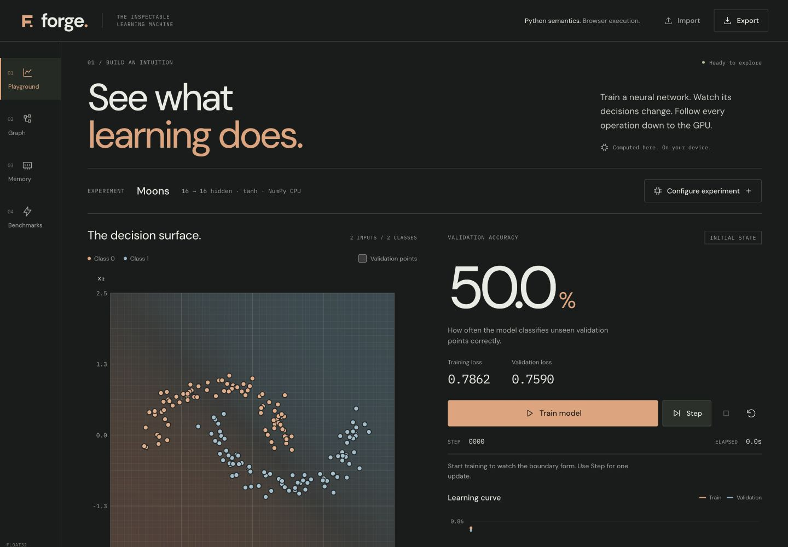
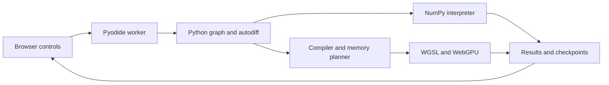

# Forge

An inspectable Python deep-learning framework and WebGPU compiler. Train a small network, follow its gradients, inspect generated shaders and memory lifetimes, and measure optimization tradeoffs in a static browser playground.

[](pyproject.toml)
[](LICENSE)
[](https://dhanushkrishna4.github.io/Forge/)

[Live demo](https://dhanushkrishna4.github.io/Forge/) · [Documentation](#documentation) · [Validation](#validation-and-results) · [License](#license)



## Highlights

- **Train and inspect:** XOR, moons, spiral, editable custom points, and a digits workspace with a trained checkpoint, probabilities, confusion matrix, and 8×8 drawing canvas.
- **Follow the computation:** shared dependencies, forward/backward graphs, bounded tensor values and gradients, compiler passes, and the actual generated WGSL.
- **Understand memory:** full forward/backward/update lifetimes and scratch-buffer reuse, with planned capacity distinguished from total browser or GPU memory.
- **Measure tradeoffs:** optimized/unoptimized fixtures, synchronized timings, warmups, repeated samples, variability, and downloadable benchmark JSON.
- **Keep work local:** train, pause, step, stop, reset, and restore validated JSON checkpoints without an account, API key, or inference service. CPU training remains available without WebGPU.

## How it works

Forge implements the immutable tensor graph, reverse-mode differentiation, SGD/momentum/Adam, compiler passes, memory planning, and WGSL generation in `src/forge_ml/`. NumPy supplies arrays and numerical primitives; PyTorch is an optional development-only reference, never an execution backend.



The same Python package runs natively and in Pyodide. The TypeScript interface dispatches Python-generated plans. GPU weights and optimizer state stay resident between steps; inspection and export trigger explicit readbacks outside timed benchmarks. Device loss offers recovery onto CPU from the last completed checkpoint.

## Run locally

The recorded environment uses **Python 3.13.12** and **Node.js 26.4.0**. Start in the repository root:

```sh
python3.13 -m venv .venv
.venv/bin/python -m pip install -r requirements-dev.txt
.venv/bin/python scripts/prepare_assets.py --runtime
npm --prefix web ci
npm --prefix web run dev
```

Open **http://127.0.0.1:5173/Forge/**. Initial preparation downloads about 16 MiB of pinned Pyodide 0.27.7 and NumPy 2.0.2 assets. Subsequent runs reuse them; the site serves its runtime locally. Native NumPy is pinned separately to 2.2.6, with parity checked against explicit arrays. Nothing trains automatically, and only one experiment trains at a time.

Native examples and package verification:

```sh
PYTHONPATH=src .venv/bin/python examples/tensors.py
PYTHONPATH=src .venv/bin/python examples/xor.py
.venv/bin/python -m build
.venv/bin/python scripts/check_wheel.py
```

An installed wheel needs `--digits-asset /absolute/path/to/digits.json` for digits training. On macOS, an editable-install `.pth` hidden by a sync utility may require `PYTHONPATH=src`; see the [setup guide](docs/deployment.md).

## Validation and results

These are **recorded measurements**, not claims that every device or configuration has passed the same checks.

| Evidence | Recorded result |
| --- | --- |
| Native implementation | 302 tests, including independent PyTorch comparisons in the recorded reference-enabled run |
| Production browser | 13/13 CPU checks with WebGPU disabled; 14/14 WebGPU checks on an Apple Metal adapter; 25 numerical fixtures per backend |
| Digits checkpoint | 272/279 correct (**97.491%**) on the held-out test split; checkpoint selected by validation loss |
| Complete Adam-step fixture | Median 1.8 ms unoptimized → 1.3 ms optimized, across 15 synchronized samples after three warmups |
| Scratch reuse fixture | Planned capacity 45,056 → 8,192 bytes, with the same 0.6 ms median |

The digits MLP has 6,570 parameters and a fixed 1,252/266/279 train/validation/test split. Step 310 of an 800-step run was selected without consulting test accuracy. The live confusion matrix uses validation data; saved test results remain separate. Builds use the trained artifact and never retrain it.

```sh
PYTHONPATH=src .venv/bin/python -m pytest -q --ignore=tests/test_reference.py
.venv/bin/python -m pip install -r requirements-reference.txt
PYTHONPATH=src .venv/bin/python -m pytest tests/test_reference.py -v -s
```

See the [validation record](docs/validation.md), [digits metrics](web/public/assets/digits-checkpoint.metrics.json), [CPU report](benchmarks/browser-cpu.json), [WebGPU report](benchmarks/browser-webgpu.json), and [benchmark samples](benchmarks/). Missing GPU support is never counted as a pass.

## Scope and limitations

- Float32 contiguous tensors of ranks 0–2, positive static shapes, and NumPy-style broadcasting; native float64 supports validation. The [operator contract](docs/operators.md) defines supported operations and domain checks.
- No dynamic shapes, strided aliasing, in-place graph mutation, higher-order derivatives, general Python compilation, convolution, transformers, or distributed training.
- Default limits include 100,000 parameters, 1,048,576 elements per tensor, 10,000 compiled nodes, and 128 MiB of aggregate Forge-owned GPU capacity. Driver/runtime overhead is separate.
- WebGPU requires a supported adapter and HTTPS or localhost. The recorded browser environment is Chrome 155 on macOS; other environments need their own acceptance run.
- Fewer dispatches do not guarantee faster execution. Reported timings are fixture-specific; CPU/GPU trajectories are compared within justified tolerances, not promised bit-identical.
- Drawn digits can differ substantially from the training distribution. Checkpoints are bounded, validated data-only JSON; imported executable code and pickle are not supported.

## Documentation

| Guide | Contents |
| --- | --- |
| [Architecture](docs/architecture.md) / [implementation](docs/IMPLEMENTATION.md) | Graph schema, worker protocol, execution and recovery |
| [Operators](docs/operators.md) / [autodiff](docs/autodiff.md) / [compiler](docs/compiler.md) | Numerical contracts, derivatives, passes, and memory planning |
| [Validation](docs/validation.md) | Tolerances, reference checks, artifact reproduction, and measured limitations |
| [Deployment](docs/deployment.md) | Native installation, static builds, and Pages publishing |
| [Interface review](docs/redesign/README.md) / [sharing card](tools/og/README.md) | Browser captures, design checks, and editable OG artwork |

## Deployment

The production artifact is `web/dist/`. Build and preview at the actual repository subpath:

```sh
.venv/bin/python scripts/prepare_assets.py --runtime
PYTHONPATH=src .venv/bin/python scripts/generate_gpu_fixtures.py
npm --prefix web run build
.venv/bin/python scripts/serve.py --port 4173 --base /Forge/
```

Open **http://127.0.0.1:4173/Forge/** and run browser acceptance at `/Forge/validation.html`. Serve over HTTP, not `file://`; SharedArrayBuffer and cross-origin isolation are not required.

Pushes run checks only. Publishing uses the explicit manual [Pages workflow](.github/workflows/pages.yml). See the [deployment guide](docs/deployment.md) for the complete process.

## License

Forge is licensed under the [MIT License](LICENSE). Dependencies and the digits dataset retain their own licenses; see [third-party notices and research attribution](THIRD_PARTY_NOTICES.md).
