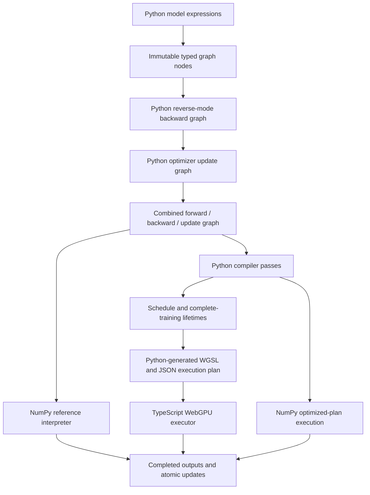

# Architecture

Forge has one Python tensor semantics and differentiation system. The native and browser paths load the same `forge_ml` source package. The browser's TypeScript layer owns interaction, worker messaging and WebGPU resources; it does not reproduce tensor rules or optimizer mathematics.

## Package responsibilities

| Module | Responsibility |
|---|---|
| `graph.py` | Immutable node records, stable IDs, normalized attributes, shape/type/resource validation and JSON graph records. |
| `tensor.py` | Arithmetic expressions build graph nodes; operations have no eager value. |
| `autodiff.py` | Reverse traversal, contribution accumulation, broadcast reductions and explicit backward graph construction. |
| `interpreter.py` | NumPy execution of the unoptimized graph; `apply_op` also defines compiler constant-folding and CPU plan semantics. |
| `optim.py` | SGD, momentum and Adam expressed using graph operations; named state and out-of-place updates. |
| `compiler.py`, `wgsl.py` | Validation, DCE, folding, CSE, pointwise fusion, scheduling, lifetime allocation and shader emission. |
| `model.py` | Bounded MLP construction, seeded initialization, batches, training, evaluation and truthful inspection. |
| `datasets.py` | Seeded 2D data and validated static digits loading with reproducible splits. |
| `serialization.py` | Versioned JSON, checksums and validation; reconstruct trusted model graphs from bounded configuration. |
| `bridge.py` | Coarse JSON commands used by the Pyodide worker. |
| `benchmark.py`, `cli.py` | Reproducible local workloads, measurements and training artifact generation. |

`Graph` is an append-only builder. Each existing `Node` is frozen, and nested attributes are immutable. IDs remain stable after more nodes are added. Constants own immutable numeric values; parameters, inputs and optimizer state refer to named external bindings. Replacing a completed-step binding does not change graph structure or require shader recompilation.

Only rank-0, rank-1 and rank-2 static shapes are supported. Normal execution is float32; float64 is a native numerical-validation mode. Class labels use int32. Binding arrays must match declared shapes and dtypes exactly. Transpose, broadcast and reshape materialize contiguous storage; there are no storage aliases or exposed mutable views. Python truthiness, equality/inequality branching and implicit array conversion fail explicitly. Compare node IDs when graph identity is needed. See [the operator contract](operators.md).

## Execution and update boundaries

The reference interpreter snapshots all reachable mutable bindings before evaluating operations. Requested values and every optimizer update are computed from the old parameter/state version. Updates commit only after successful execution. Failed native training rolls back its sampled-batch RNG state too. No tensor has a mutable `.grad` accumulation field.

The compiler sees the whole forward/backward/update computation. A forward activation remains live until its final backward consumer. Scratch capacity may be reused only when the previous tensor's last use precedes the new output's dispatch. Persistent parameters, optimizer state, inputs and observable outputs have distinct roles. A dispatch cannot overwrite an input buffer with its output.

The generated plan contains nodes, source mappings, kernels, WGSL, buffer capacities, lifetimes, output/update roots, pass changes and a structural cache key. Optimizer formulas remain Python-generated. The WebGPU layer uploads buffers, compiles shaders, dispatches the plan, awaits completion and performs explicit readbacks. Weights and moments remain resident between steps. Evaluation copies current parameter buffers to another executor on the same device using GPU-to-GPU copies.

CPU optimized-plan execution supports the same conservative graph transformations. GPU fusion is a shader-generation optimization: Forge does not describe it as accelerating NumPy. A separate schedule-replay mode writes actual planned storage slots to verify lifetime reuse natively. It cannot establish shader correctness; browser GPU conformance is a separate check. See [compiler and memory details](compiler.md).

## Browser boundary and recovery

React renders the application on the main thread. `client.ts` owns a module worker; `worker.ts` lazy-loads the pinned Pyodide runtime and NumPy package, unpacks Forge's static Python archive, and invokes the same Python model/compiler modules. Runtime assets and datasets resolve relative to Vite's configured base, including a repository subpath.

Requests exchange configuration, execution plans, bounded batches, snapshots and numeric readbacks as JSON. They do not cross the Python/JavaScript boundary per tensor operation. Temporary Python globals are removed after each call; this JSON boundary exposes no long-lived PyProxy or mapped GPU buffer view to the interface.

The worker serializes commands. Browser training requests contain at most five steps; the interface can stop requesting further groups on pause. GPU groups yield between steps. Request IDs, run IDs and worker-generation IDs prevent results from reset or replaced workers from overwriting newer state. This design does not need SharedArrayBuffer, cross-origin isolation or Pyodide's preemptive interrupt mechanism.

The client watchdog replaces an unresponsive worker after 60 seconds for ordinary requests, or 180 seconds for boot/benchmarks. Worker termination is recovery; GPU commands already submitted may have completed. Editor configuration and the last exported completed checkpoint stay outside the transient worker. Device loss and unsupported WebGPU produce explicit recovery choices. Whole-graph CPU recovery is available; individual GPU operations do not silently move to NumPy.

A selected tensor is inspected in a separate NumPy run using the current synchronized parameters and batch, with at most 64 displayed elements. The UI labels this instrumentation. An optimized plan's removed or fused values are not invented. Full compiler instrumentation can retain every source node, changing its allocations and dispatch count. Instrumented runs are excluded from performance measurements.

## Bounded resource model

| Resource | Bound |
|---|---|
| Tensor rank/elements | Rank 0–2; 1,048,576 elements per tensor by default. |
| Parameters | At most 100,000 elements. |
| Graph size | Builder default 20,000 nodes; compiler additionally caps at 10,000 nodes. |
| Playground MLP | 1–3 hidden layers, 1–64 units each. |
| 2D data | 20–2,048 generated rows; 6–2,048 custom rows, with at least three examples per class. |
| Digits | Exactly 1,797 rows ×64 features, values normalized by the fixed physical range 16. |
| Batches/steps | Batch 1–128, bounded by available training rows; at most 10,000 native steps or 5,000 interactive steps. |
| Execution groups | Native 1–100 steps; browser 1–5 steps. |
| Reference interpreter | Default 128 MiB for reachable graph-owned arrays, checked before execution. |
| GPU allocations | Default 128 MiB aggregate Forge-owned capacity across shared-device executors and staging; actual device limits also apply. |
| Fusion | Default 8 operations and 8 storage bindings including the output; explicit bounded compiler options. |
| Serial shader work | At most 64 million estimated scalar loop operations per kernel by default. |
| Python caches | At most 8 model programs and 8 compiled plans per experiment. |
| Checkpoint imports | At most 8 MiB; bounded tensor records, configuration, history and metadata. |

These counters describe Forge-owned storage, not total browser/process memory or physical GPU residency. NumPy temporary arrays, Python/Pyodide, React, WebAssembly, shader caches and driver overhead are additional. Native RSS reports include runtime overhead; benchmark reports distinguish that from persistent tensor bytes.

## Reproducibility and trust

The static digits asset contains original 8×8 pixels, labels, provenance, a SHA-256 data checksum and a fixed seed-2026 stratified partition. Normalization is `float32(pixel)/16`, with no statistics fitted on validation or test data. Training initializes parameters from explicit seeded arrays; independent reference tests receive those exact arrays instead of assuming another library's initializer uses the same seed convention.

Exports are detached snapshots: configuration, dataset identity/splits, parameters, all optimizer state, Adam's step, batch RNG state, compiler/training settings, history and backend metadata. Imports verify version, checksum, numeric finiteness, shapes, dtypes, bounds, dataset identity, state names and counters before accepting state. Imported configuration rebuilds a trusted graph. No pickle, Python source, JavaScript, or imported arbitrary shader is executed.

Experiment checksums hash a normalized representation of the JSON payload, not its original JSON text. Strings, booleans, nulls, lists and objects receive distinct type tags; object keys are sorted. Each finite numeric value is encoded as its exact binary64 hexadecimal representation, and signed zero is normalized to zero. Consequently JavaScript changing `1.0` to `1`, or changing decimal exponent spelling, does not invalidate the checksum. Numeric integers outside JavaScript's safe range (`2**53-1` in magnitude) are rejected instead of silently losing precision. SHA-256 detects changed content; it is not a digital signature or proof of who authored an experiment.

PCG64's 128-bit `state` and `inc` fields exceed that safe JSON number range, so export stores them as decimal strings. Import validates their bounded decimal syntax and 128-bit range, requires an odd increment, checks the remaining generator flags, then restores Python integers before assigning NumPy's RNG state. This preserves the next sampled batches across an actual Python →JavaScript →Python JSON round trip. The underlying tensor values remain ordinary bounded numeric arrays, not hexadecimal strings.

Matching seeds and settings permit deterministic continuation on the same tested backend. Floating-point reductions and device implementations can differ; cross-device bitwise reproducibility is not promised.
